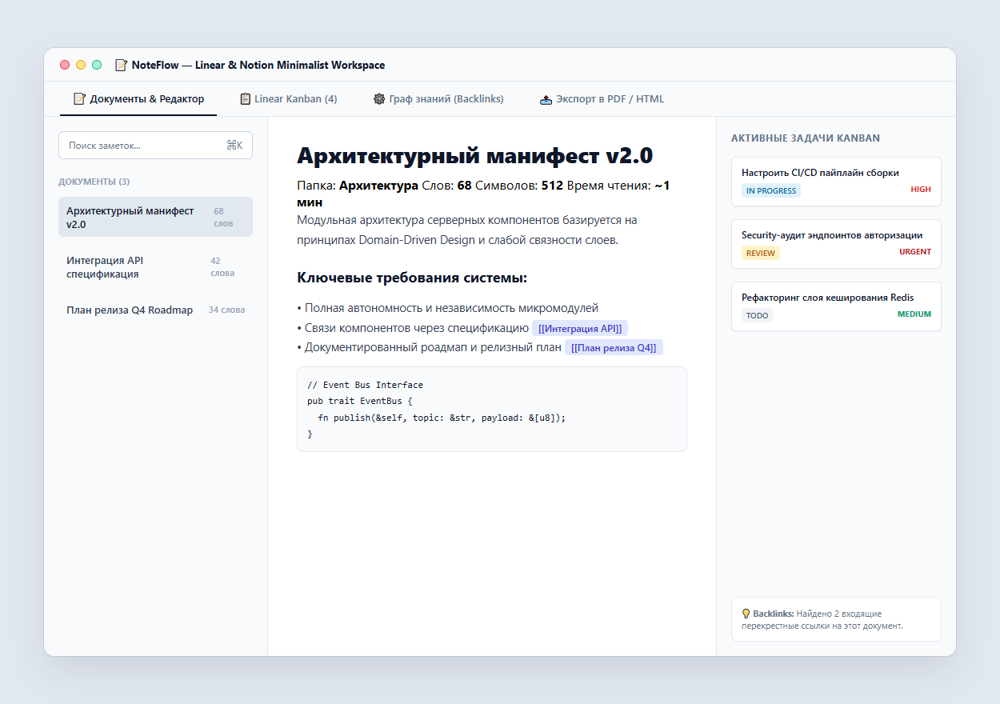

# NoteFlow Workspace

Минималистичное рабочее пространство для ведения документации, управления задачами (Linear-style Kanban) и построения двунаправленного графа знаний (Backlinks).

Выполнено в ультрачистом **светлом дизайне (Light Mode / Linear & Notion aesthetic)**: светлый фон `#F8FAFC`, тонкие hairline-границы, карточки с глубокой контрастной типографикой и акцентами цвета изумруда и индиго.



## Архитектура проекта

```text
noteflow-workspace/
├── noteflow/
│   ├── config.py              # Настройки светлой темы и директорий хранения
│   ├── storage/
│   │   └── db.py              # Слой SQLite: заметки, задачи Kanban и wiki-связи
│   ├── core/
│   │   ├── markdown_parser.py # Парсер Markdown, вики-ссылок [[link]] и метрик чтения
│   │   └── graph_engine.py    # Построение матрицы графа знаний и индексация связей
│   └── ui/
│       └── app.py             # Светлый интерфейс на CustomTkinter (4 вкладки)
├── tests/                     # Unit-тесты для Markdown и графа знаний
├── run_workspace.py           # Точка входа для запуска GUI
└── requirements.txt
```

## Вкладки и функционал

1. **📝 1. Документы & Редактор:**
   - Дерево заметок в сайдбаре с поиском и счетчиком слов.
   - Редактор Markdown с поддержкой подсчета слов, символов и ориентировочного времени чтения.
   - Поддержка двунаправленных вики-ссылок формата `[[Название Заметки]]`.

2. **📋 2. Задачи (Linear Kanban):**
   - 4 колонки жизненного цикла: `To Do`, `In Progress`, `Review`, `Done`.
   - Градация приоритетов (Low, Medium, High, Urgent) с цветовой индикацией.

3. **🕸️ 3. Граф знаний & Backlinks:**
   - Автоматический расчет входящих и исходящих связей между документами.
   - Индексация графа зависимостей и сквозных ссылок.

4. **📤 4. Экспорт & Публикация:**
   - Генерация автономных HTML-страниц в чистом типографическом стиле для публикации в веб или отправки коллегам.

## Запуск

1. Клонируйте репозиторий:
   ```bash
   git clone https://github.com/username/noteflow-workspace.git
   cd noteflow-workspace
   pip install -r requirements.txt
   ```
2. Запустите приложение:
   ```bash
   python run_workspace.py
   ```
3. Запуск тестов:
   ```bash
   pytest
   ```

